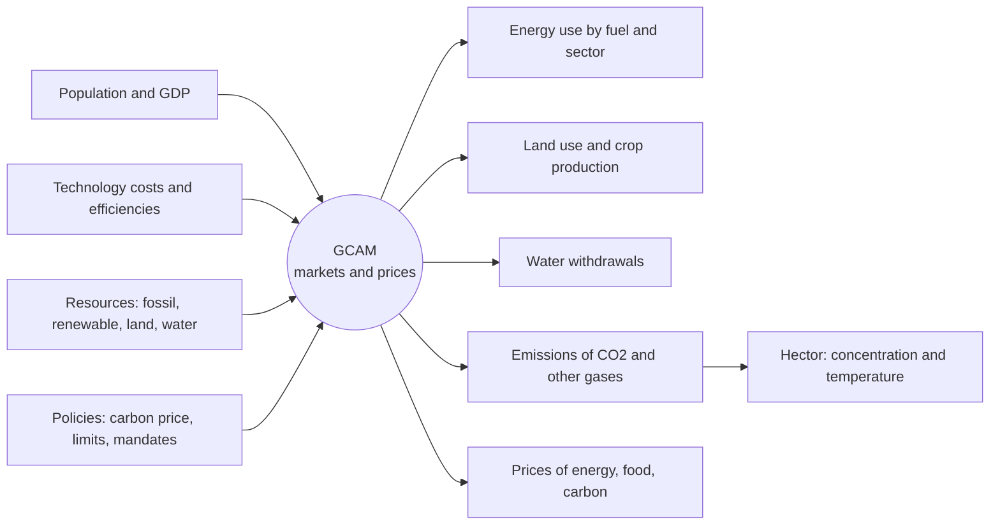
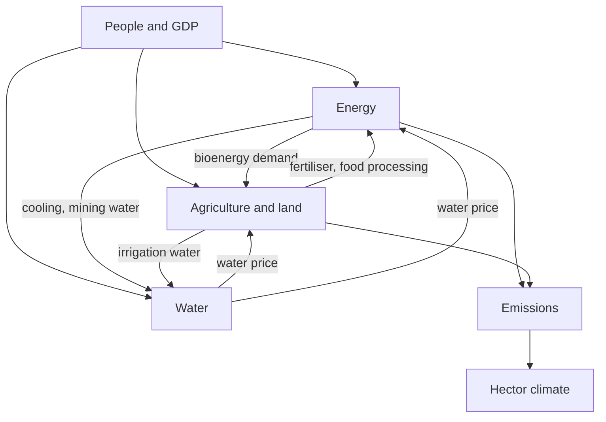
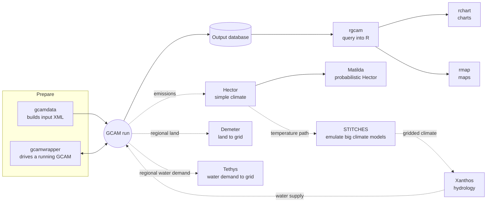
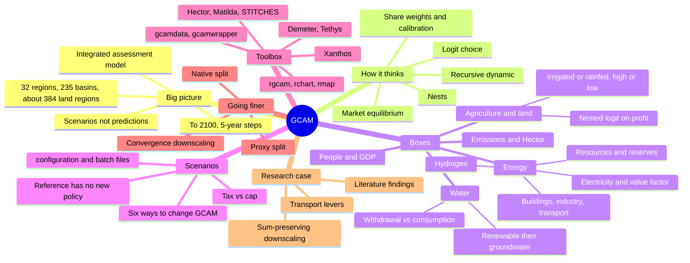

# GCAM from Zero: A Beginner's Study Guide

*An intuition-first guide to the Global Change Analysis Model (GCAM), its toolbox, and how researchers use it. Built from every set of materials in the course folder (listed in [Where this guide comes from](#where-this-guide-comes-from)).*

> **How to use this guide.** Read one part per sitting. Each part opens with **the big idea in one sentence**, builds up slowly, gives you **a worked calculation you can do by hand**, warns you about **one trap**, and ends with a **recap that keeps growing**. At the end you will find a memory route, a mind map, a 20-question self-quiz with answers, and a one-page cheat sheet.
>
> **Numbers in this guide.** Worked examples use small, made-up numbers so you can follow the arithmetic. Facts about GCAM (region counts, model structure) come from the 2025 GCAM Annual Meeting training slides and the GCAM documentation. They change between GCAM versions, so check them against the version you install.

---

## Contents

0. [Where this guide comes from](#where-this-guide-comes-from)
1. [Part 1 – The big picture: what an integrated assessment model is](#part-1--the-big-picture)
2. [Part 2 – How GCAM thinks: markets, prices and choices](#part-2--how-gcam-thinks)
3. [Part 3 – A tour of the boxes: energy, land, water, climate](#part-3--a-tour-of-the-boxes)
4. [Part 4 – Scenarios: asking GCAM "what if?"](#part-4--scenarios)
5. [Part 5 – The GCAM toolbox: from database to maps](#part-5--the-gcam-toolbox)
6. [Part 6 – Going finer: from regions to countries and grids](#part-6--going-finer)
7. [Part 7 – A research case: net-zero transport](#part-7--a-research-case-net-zero-transport)
8. [Part 8 – Your learning path](#part-8--your-learning-path)
9. [Memory route](#memory-route)
10. [Mind maps](#mind-maps)
11. [Traps to avoid](#traps-to-avoid)
12. [Self-quiz (20 questions)](#self-quiz)
13. [Cheat sheet](#cheat-sheet)
14. [Glossary](#glossary)
15. [Answer key](#answer-key)

---

## Where this guide comes from

| Material in the folder | What it contributed |
| --- | --- |
| `GCAM-2025-Training/GCAM_Summary_Training_2025.pptx` – PNNL sectoral overview (Graham, Iyer, Zhao, June 2025) | Model scope, solution method, logit choice, energy, agriculture/land, water (Parts 1–3) |
| `GCAM-2025-Training/*_notebook.pdf` – ten official training notebooks: gcam-scenarios, rgcam, rchart, rmap, Hector, Matilda, STITCHES, Xanthos, Demeter, Tethys | Scenario design and modification (Part 4); the toolbox (Part 5) |
| `Zaid/GCAM_Basics_07Oct26.pptx` – GCAM framework, concepts and a five-step learning path | Plain-language framing (Part 1), learning path (Part 8) |
| `Running GCAM for a Region and Recovering Country-Level Results.docx` | Downscaling routes and workflow (Part 6) |
| `GCAM_Transport_NetZero_Report.docx` | Transport levers and literature findings (Part 7) |
| `Claude-Learning/` – 15-week course, three-goes course, labs 1–14, toy models, transport kit | Learning path and links to hands-on practice (Part 8) |

The three videos in `Zaid/` are not transcribed here.

---

## Part 1 – The big picture

> **Big idea:** An integrated assessment model (IAM) is a consistent "what if" machine. It links people, the economy, energy, land, water and climate so that a change in one place shows up everywhere else. It is **not** a crystal ball.

### 1.1 Why "integrated"?

Picture a city where the water company, the power company and the farmers never talk. The power company builds plants that need cooling water. The farmers expand irrigation. Both assume the river is all theirs. On paper each plan works. In reality the river runs dry.

An IAM makes everyone talk. In GCAM:

- More **people** and more **income** → more demand for energy, food and water.
- **Energy** needs land (bioenergy) and water (cooling, mining).
- **Land** use changes carbon in soils and forests.
- All of it produces **emissions**, which change the **climate**.

### 1.2 GCAM in one paragraph

GCAM is developed at the Joint Global Change Research Institute (Pacific Northwest National Laboratory, PNNL). It is a **multi-sector, multi-region, dynamic** model that links energy, agriculture, land, water, emissions and climate to **2100**, usually in **5-year steps**. It solves each period by finding the prices at which supply equals demand in every market. A simple climate model, **Hector**, turns emissions into concentrations, forcing and temperature.

### 1.3 How GCAM slices the world

| Layer | Pieces (2025 training slides) | Why that size |
| --- | --- | --- |
| Energy and economy | **32 regions** | Countries or groups of countries with their own markets |
| Water | **235 basins** | Water follows rivers, not borders |
| Land | **384 land regions** (the 32 regions × 235 basins overlap; 396 with a Ukraine split; one slide shows 391) | Land needs both an economy (who farms) and water (where) |
| United States option | **GCAM-USA: 50 states** | For state-level policy |

Different versions report slightly different land-region counts. That is normal: count them in your own version.

### 1.4 What goes in, what comes out



### 1.5 Three words to get right on day one

- **Top-down vs bottom-up.** Zaid's slides call GCAM "top-down" in the sense that one market framework spans the whole world economy. It still has a lot of **technology detail** (four types of coal plant, many vehicle types), which is the "bottom-up" flavour. Think of GCAM as a hybrid.
- **Recursive dynamic.** GCAM solves 2025, then 2030, then 2035. Decision makers in 2030 do not know what happens in 2050. (Contrast: an *intertemporal optimisation* model chooses all years at once, with perfect foresight.)
- **Scenario.** A coherent set of assumptions. GCAM's answers depend on them (Part 4).

> **Trap:** "GCAM predicts that in 2050…". No. GCAM shows what follows *if* the assumptions hold. Always say "in this scenario".

> **Two-minute exercise.** Name one chain of cause and effect that crosses three GCAM systems. *(Example: a carbon price → more bioenergy → more cropland for energy crops → higher food prices.)*

**Recap after Part 1**
1. An IAM links people, economy, energy, land, water and climate so that changes ripple through.
2. GCAM: 32 energy-economy regions, 235 water basins, about 384 land regions, to 2100 in 5-year steps.
3. GCAM is recursive dynamic (no perfect foresight) and gives scenario results, not predictions.

---

## Part 2 – How GCAM thinks

> **Big idea:** GCAM is a giant marketplace. In each period it searches for the set of prices at which **every supply equals every demand**. Prices are the messages the sectors send each other. Who wins a market is decided by a **logit** choice: cheaper options get bigger shares, but not all of the market.

### 2.1 Market equilibrium, slowly

Imagine one market: electricity in one region.

- If the price is too low, people want more electricity than plants will supply → raise the price.
- If the price is too high, plants supply more than people want → lower the price.
- The **equilibrium price** is where the two meet. The market "clears".

GCAM does this for thousands of linked markets at once (electricity, refined liquids, crops, land, water, carbon…). Its solver keeps adjusting all prices together until all markets clear within a tolerance. Then it moves to the next 5-year period.

Because each period is solved on its own terms, GCAM's results are **not** necessarily the cheapest path over the century. That is a feature: it mimics actors who do not see the future.

### 2.2 Why not just pick the cheapest technology?

If coal power costs $50 and gas costs $51, a pure cost-minimiser gives **100 %** to coal. Real markets do not behave like that: sites differ, firms differ, people have preferences. GCAM assumes each actor faces a slightly different cost, so the cheapest option on average wins the **biggest share**, not all of it.

This is the **logit choice**. For technologies *i* with cost *cᵢ*:

```
share_i  =  αᵢ · cᵢ^λ  /  Σⱼ ( αⱼ · cⱼ^λ )
```

- **αᵢ (share weight)**: a dial for everything that is not cost (preferences, infrastructure, barriers). Set during calibration.
- **λ (logit exponent)**: negative. The more negative, the more strongly cost differences matter.

### 2.3 Worked calculation: three power technologies

Costs: coal $50, gas $60, solar $80 per MWh. Share weights 1, 1, 0.5. Exponent λ = −6.

| Step | Coal | Gas | Solar |
| --- | --- | --- | --- |
| cost^λ = cost^−6 | 50⁻⁶ = 6.40 × 10⁻¹¹ | 60⁻⁶ = 2.14 × 10⁻¹¹ | 80⁻⁶ = 0.38 × 10⁻¹¹ |
| × share weight | 6.40 | 2.14 | 0.19 (× 10⁻¹¹) |
| ÷ total (8.73) | **73.3 %** | **24.5 %** | **2.2 %** |

Now three experiments:

- **Solar cost falls to $60:** shares become 66.6 % / 22.3 % / 11.1 %. Solar quintuples, but does not take over: its share weight of 0.5 still holds it back.
- **Exponent softened to λ = −3** (original costs): 58.8 % / 34.0 % / 7.2 %. Cost matters less, so shares spread out.
- **Share weight of solar set to 0:** solar gets 0 % no matter how cheap. This is how GCAM keeps a technology out until its start year.

### 2.4 Share weights and calibration

GCAM is **calibrated** to a historical base year (the 2025 training uses **2021**, averaging 2020–2022). In calibration mode GCAM works out the share weights that make the model reproduce the base year **exactly**. The technology with the largest share gets a share weight of 1; others are set relative to it.

So a share weight is a **memory of history**: it soaks up everything costs alone cannot explain. Two rules from the official scenario notebook:

1. Be careful changing calibrated share weights of technologies that already exist. You are overriding observed behaviour.
2. To phase in a **new** technology, start its share weight low and raise it toward 1 over time. A share weight of 1 means "compete on cost alone".

### 2.5 Nests

Choices are stacked. Transport, for example: first choose a **mode** (road, rail, air), then a **sub-mode** (bus, car), then a **size class**, then a **drivetrain** (petrol, battery-electric, hydrogen). Each level is its own logit. Land uses the same idea (Part 3).

### 2.6 Non-linear by design

The training slides stress that GCAM's supplies, demands and production functions are non-linear: marginal costs rise as you use more of a resource, returns diminish. That is why GCAM does **not** need hard linear limits to stop one technology from taking 100 % of a market.

> **Trap:** "A share weight is a subsidy." No. It is not a cost and does not appear in prices. It shifts the share for a given cost.

> **Two-minute exercise.** With the starting numbers, what happens to the coal share if gas gets a share weight of 2? *(Answer in the [answer key](#answer-key).)*

**Recap after Part 2**
1. An IAM links people, economy, energy, land, water and climate so that changes ripple through.
2. GCAM: 32 energy-economy regions, 235 water basins, about 384 land regions, to 2100 in 5-year steps.
3. GCAM is recursive dynamic (no perfect foresight) and gives scenario results, not predictions.
4. Each period, GCAM finds the prices that clear every market. Prices carry signals between sectors.
5. Logit choice: cheaper options win bigger shares, not everything. Share weights (calibrated to 2021) hold non-cost factors. λ sets cost sensitivity.

---

## Part 3 – A tour of the boxes

> **Big idea:** GCAM has five big systems – **people and economy, energy, agriculture and land, water, emissions and climate** – and they are coupled through shared markets and physical flows.

### 3.1 People and economy (the drivers)

- **Population** and **GDP** set the scale of everything. In the 2025 version these come from the **SSP database v3**.
- Labour productivity is calibrated to match per-capita GDP growth.
- Swapping in a different SSP (SSP1 to SSP5) changes the size of the world's demand for energy, food and water.

### 3.2 Energy

Think of the energy system as four layers: **resources → transformation → distribution → final demand**.

**Fossil resources: a resource–reserve model.**
*Resources* are all that is in the ground. *Reserves* are the part that has been developed (a well or a mine). New reserves are added according to a supply curve (cheapest first) and produced over a well or mine lifetime. Technology change slowly lowers extraction costs.

**Renewable resources.** Onshore and offshore wind, solar, geothermal, hydro, biomass (plus traditional biomass in some regions). Wind and rooftop solar have supply curves: the best sites go first, so costs rise. Utility solar PV and CSP are treated as unlimited. Wind and solar come with and without storage.

**Electricity.** Existing plants keep running for their lifetime as long as they cover operating costs. **New** capacity is chosen by levelised cost (capital, O&M, fuel, plus integration costs for variable renewables).

*Worked calculation – the value-factor idea (from the 2025 slides).* Variable renewables are worth less per MWh as they become a larger share of supply (they all produce at the same sunny or windy hours). GCAM captures this with a **profitability-adjusted LCOE**:

```
PLCOE = LCOE / value factor        integration cost = PLCOE − LCOE
```

A solar plant with LCOE $40/MWh and a value factor of 0.8 → PLCOE = 40 / 0.8 = **$50**, so the integration cost is **$10/MWh**. As solar's share grows, the value factor falls (linearly with share in GCAM), and the integration cost rises faster and faster.

**Hydrogen.** Produced in 10 "central" routes and 2 "forecourt" (on-site) routes, from gas, coal, biomass (with and without CCS) and electrolysis, with explicit transmission and distribution losses.

**Final demand sectors.**

| Sector | How demand grows | Detail |
| --- | --- | --- |
| **Buildings** | Floorspace per person rises with income, then **saturates** | Residential and commercial; heating, cooling, other; residential split into income deciles; climate (heating and cooling degree days) matters |
| **Industry** | Income elasticities | Iron and steel, chemicals, aluminium, cement, fertiliser, pulp and paper, food processing, construction, mining, agricultural energy, other |
| **Transport** | Per-capita GDP, income elasticity, service price, price elasticity, population | Four final demands: passenger air, other passenger, international shipping, other freight. Mode choice depends on cost, **travel time**, and income |

**Trade.** Most fuels are traded through a global pool using an **Armington** structure (gross imports and exports kept separate). Natural gas moves by LNG globally and through **6 regional pipeline networks**. GCAM can represent anything from fully global trade to bilateral trade to no trade.

### 3.3 Agriculture and land

- **Every** hectare is represented: crops, pasture, forest, grass and shrub, and other natural land. About 80 land types once crop technologies are counted.
- Land is shared out by a **nested logit** on profit per hectare. More profitable uses expand, but gradually.
- Each crop has four ways to be grown: **irrigated or rainfed, × high or low input**. Irrigated crops buy water from the water module. A price rise shifts land toward high-yield practices (*price-induced intensification*).
- Calibrated to historical data (via the `moirai` and `gcamfaostat` data tools) so the base year is reproduced exactly.
- **Food demand** grows with income and population, with calorie-based competition between staples and non-staples.
- **Links to energy**: bioenergy crops, fertiliser, food processing, pulp and paper.

**Land-use change emissions.** If a land unit changes between two periods, GCAM computes the change in soil and vegetation carbon. If nothing changed, no new land-use emissions. Agricultural non-CO₂ gases (methane, nitrous oxide and others) use emission factors calibrated to the CEDS inventory.

### 3.4 Water

- **Supply**: each of 235 basins has a renewable-water cost curve (built from the **Xanthos** hydrology model) and a **groundwater** cost curve (from **Superwell**, in 24 cost grades). Cheap water goes first. When renewable water runs short, price rises until groundwater is competitive.
- **Demand**: agriculture (irrigation), electricity (cooling), primary energy (mining), manufacturing, domestic, livestock.

Know the difference:

| Term | Meaning |
| --- | --- |
| **Withdrawal** | Water taken from a river or aquifer (some may be returned) |
| **Consumption** | Water that does not return (evaporated, transpired, built into products) |
| **Biophysical consumption** | All water crops evapotranspire: blue (rivers and groundwater) + green (soil moisture) |
| **Seawater** | Ocean or brackish water used for cooling or desalination |

### 3.5 Emissions and climate

GCAM tracks CO₂ and the other main greenhouse gases plus air pollutants. Emissions go to **Hector**, a reduced-complexity Earth system model, which returns CO₂ concentration, radiative forcing and global temperature. (Part 5 shows how to run Hector on its own.)



> **Trap:** "GCAM's reference scenario includes climate change impacts." By default it does **not**: the reference configuration holds heating and cooling degree days flat after 2015, and the reference has no explicit climate policy.

> **Two-minute exercise.** A carbon price makes bioenergy attractive. Trace two effects outside the energy box. *(Hint: land and water.)*

**Recap after Part 3**
1–5. *(as before)*
6. Drivers: population and GDP from the SSP database. Energy: resources → transformation → distribution → buildings, industry, transport.
7. New power plants compete on levelised cost; variable renewables pay an integration cost that grows with share (PLCOE = LCOE ÷ value factor).
8. Land: every hectare, nested logit on profit, crops irrigated or rainfed × high or low input.
9. Water: basin supply curves (renewable then groundwater); know withdrawal vs consumption.
10. Emissions go to Hector for concentration and temperature.

---

## Part 4 – Scenarios

> **Big idea:** GCAM's output is only as meaningful as its scenario. A scenario is a **plausible, coherent, internally consistent** set of assumptions, compared against a **reference**.

### 4.1 Definitions (from the IPCC glossary, as used in the official notebook)

- **Scenario**: a plausible description of how the future may develop, based on coherent and internally consistent assumptions. Neither a prediction nor a forecast.
- **Storyline**: the narrative behind a scenario (e.g. SSP3, a fragmented, rival world).
- **Reference scenario**: the starting point you compare others against.

GCAM's own reference has **no explicit policy** (though past policies affect calibration; GCAM-USA includes a few) and **no climate impacts**.

### 4.2 Designing scenarios: four questions

1. **How many?** Few are easy to explain; many explore more futures.
2. **One change or many?** One change isolates its effect. Several together reveal interactions.
3. **Global or regional?** Keep assumptions consistent across regions.
4. **What is the research question?** It decides 1–3.

### 4.3 The files you will meet

| File | Role |
| --- | --- |
| `configuration.xml` | Master switchboard: which input XML files to read, which years, solver settings, output database |
| Input XML files (`input/gcamdata/xml/…`) | The model's data, e.g. `socioeconomics_SSP3.xml`, `solar_low.xml` |
| Add-on / policy XML (`input/policy/…`) | Carbon prices, emission limits, mandates |
| Batch file | Runs many scenarios from one configuration (e.g. `batch_SSP_REF.xml` holds the full, consistent SSP file sets) |
| Output database (BaseX) | Results, read with ModelInterface queries or `rgcam` |

### 4.4 Six ways to change GCAM (easiest → most robust)

| Method | Good for | Watch out |
| --- | --- | --- |
| **Hand-edit an XML** | Quick tests, simple policy files | Easy to make mistakes (did you include all 32 regions?) and hard to trace |
| **Use pre-existing XMLs** | SSPs, low/advanced tech costs, CCS options, carbon price paths | Keep the set internally consistent |
| **Change gcamdata inputs** and run `driver_drake()` | Long-lived changes; anything you might return to core GCAM | Hard to predict which XMLs change; `driver_drake()` only rebuilds what changed |
| **R script + gcamdata helpers** (`create_xml()`, `add_xml_data()`, `run_xml_conversion()`) | New data (e.g. a national GDP forecast) without writing a chunk | May miss downstream dependencies (use `dstrace()` to follow data) |
| **User modification functions** | Reproducible user changes kept separate from core; outputs get a suffix like `__1` | Remember to add the new XMLs to `configuration.xml` |
| **gcamwrapper** (R or Python) | Changing parameters in a *running* GCAM and reading results directly | More advanced |

Whatever you do, **track your changes**: use Git, keep your assumptions apart from the defaults, and document copies.

### 4.5 Worked calculation: reading a carbon price file

The official notebook's example carbon tax (`carbon_tax_25_5.xml`) lists a `fixedTax` for each year: **321.86** in 2025 and **373.13** in 2030.

- Growth over 5 years: 373.13 ÷ 321.86 = 1.159.
- Per year: 1.159^(1/5) = **1.03** → the price rises **3 % a year**.
- By 2100 it reaches 2954.36, about **9.2 ×** the 2025 value.

Units matter: GCAM's internal carbon prices are usually in **1990 US$ per tonne of carbon** (not CO₂). Divide by 3.667 to get per tonne CO₂, then adjust for inflation. Check the units in your version before quoting a price.

The structure is always the same:

```xml
<scenario><world>
  <region name="USA">
    <ghgpolicy name="CO2_LTG">
      <market>global</market>
      <fixedTax year="2025">321.863</fixedTax>
      <!-- ... one line per period ... -->
    </ghgpolicy>
  </region>
</world></scenario>
```

### 4.6 A tax or a cap?

- **Carbon price (tax)**: you set the price, GCAM finds the emissions.
- **Emissions constraint (cap)**: you set the emissions, GCAM finds the price that delivers it (the shadow price).

### 4.7 The golden loop

From Zaid's learning guide and the official notebook alike:

> **Run the reference → change one thing → run again → compare → explain why.**

> **Trap:** Changing a share weight to force an outcome, then reporting the outcome as a "finding". If you set the answer, you did not find it. Say clearly which results are imposed and which emerge.

> **Two-minute exercise.** You want to test cheaper batteries for electric trucks. Which method from 4.4 would you pick for a quick test, and which for a paper? *(Answer key.)*

**Recap after Part 4**
1–10. *(as before)*
11. Scenarios are coherent "what ifs", compared with a reference that has no new policy and no climate impacts.
12. `configuration.xml` chooses the inputs; batch files run sets of scenarios; results land in a database.
13. Six ways to change GCAM, from hand-editing XML to gcamwrapper; for lasting work use gcamdata and track changes.
14. Tax: set price, get emissions. Cap: set emissions, get price.

---

## Part 5 – The GCAM toolbox

> **Big idea:** GCAM sits in a family of open tools. Some **read and draw** its results, some do the **climate** side, and some **downscale** its coarse results to a fine grid.

### 5.1 The family at a glance



| Tool | Language | What it does | One thing to remember |
| --- | --- | --- | --- |
| **rgcam** | R | Pulls query results from a GCAM database into R | Needs a query XML wrapped in `<queries>` and `<aQuery>` tags |
| **rchart** | R | Standard GCAM charts across scenarios, regions, classes | Data needs columns `subRegion`, `year`, `value` (optional `param`, `scenario`, `class`) |
| **rmap** | R | Maps by GCAM region, basin, country; difference maps between scenarios | Rename `region` to `subRegion` to use the built-in maps |
| **Hector** | C++ with R package | Reduced-complexity climate model, 1745–2300 | Comes with SSP input files; change parameters like climate sensitivity |
| **Matilda** | R | Runs Hector many times with sampled parameters; weights runs by fit to history | Turns one climate line into a probability range |
| **STITCHES** | Python | Emulates full Earth system models by stitching 9-year chunks of their archived runs | Needs an archive (one model) and a target temperature path |
| **Xanthos** | Python | Global hydrology, 0.5°, monthly; runoff, evapotranspiration, soil moisture | Builds the basin water-supply curves GCAM uses |
| **Demeter** | Python | Downscales GCAM land use to a grid (e.g. 0.05°) | Run from a config file, one step or all steps |
| **Tethys** | Python | Downscales GCAM water demand to a grid (e.g. 0.125°) using proxies such as population | Keeps grid totals consistent with GCAM regional totals |
| **gcamdata** | R | The data system that turns raw data into GCAM input XML | `driver_drake()` rebuilds only what changed |
| **gcamwrapper** | R, Python | Start GCAM, run to a period, change values, read results | Good for sensitivity loops |

### 5.2 Mini-walkthroughs (code you can recognise)

**Read results with rgcam**

```r
library(rgcam)
conn <- localDBConn("path/to/output", "database_basexdb")       # connect
prj  <- addScenario(conn, "my_project.dat", "Reference",
                    queryFile = "my_queries.xml")                # extract
prj  <- loadProject("my_project.dat")                           # next time: just load
pop  <- getQuery(prj, "population by region")                    # get a table
```

Columns returned: `Units, scenario, region, year, value` (plus a class column for queries like electricity by subsector).

**Run Hector and double the climate sensitivity**

```r
library(hector)
core <- newcore(system.file("input/hector_ssp245.ini", package = "hector"))
run(core)
base <- fetchvars(core, 1850:2100, c(GLOBAL_TAS(), CONCENTRATIONS_CO2()))
ecs  <- fetchvars(core, NA, ECS())$value          # default 3 °C
setvar(core, NA, ECS(), 2 * ecs, getunits(ECS()))
run(core)                                          # core resets and reruns
high <- fetchvars(core, 1850:2100, GLOBAL_TAS())
shutdown(core)
```

Same emissions, higher sensitivity → more warming. Concentration hardly changes; temperature does.

**Matilda in three steps**: `generate_params(core, draws = 20)` samples six parameters (CO₂ fertilisation, soil respiration sensitivity, initial plant productivity, aerosol scaling, ocean heat diffusivity, climate sensitivity) → `iterate_model()` runs Hector for each → weight each run by how well it matches observed history.

**Demeter, Tethys, Xanthos** all follow one pattern: download example data, edit paths in a configuration file (`.ini` or `.yml`), call `run_model(config)`, plot the gridded output.

> **Trap:** Downscaled maps look precise. They are GCAM's regional totals **shared out** by proxies. The grid adds spatial pattern, not new information about how a place would respond.

> **Two-minute exercise.** Match the question to the tool: (a) "What is the 5–95 % range of warming for this emissions path?" (b) "Where inside the Indus basin will irrigation water demand grow?" (c) "Draw electricity generation by fuel for two scenarios." *(Answer key.)*

**Recap after Part 5**
1–14. *(as before)*
15. Read and draw: rgcam → rchart and rmap. Climate: Hector, Matilda (uncertainty), STITCHES (emulate big models). Water supply: Xanthos. Downscale: Demeter (land), Tethys (water demand). Build and drive: gcamdata, gcamwrapper.

---

## Part 6 – Going finer

> **Big idea:** GCAM's markets live at the regional level. You can still get **country** numbers, but they are *constrained estimates*, not model outputs.

### 6.1 Three routes

| Route | What it does | Cost | Best for |
| --- | --- | --- | --- |
| 1. **Downscale with convergence** (e.g. DSCALE) | Start from each country's base-year data; let its energy and emission intensity converge toward the regional path; force the countries to add up to the region | Medium | Many countries, consistent totals |
| 2. **Proxy / fixed shares** | Split regional totals by GDP, population or base-year shares | Low | Quick, transparent first look; poor when countries differ a lot |
| 3. **Native split** | Rebuild the data system so the country is its own GCAM region | High (new calibration; GCAM-Europe needs ~50 % more memory) | One country's own policy response, prices, trade |

Published country versions already exist, so check them first: **GCAM-KSA** (Saudi Arabia; 33 regions), **GCAM-LA** (South America), **GCAM-Europe**, **GCAM-USA**, **GCAM-China**, and others.

### 6.2 Worked calculation: a proxy split and its weakness

A region emits 1,000 Mt CO₂. Country A has 60 % of the region's GDP, country B 40 %.

- GDP-share split: A = 600 Mt, B = 400 Mt.
- But in the base year A actually emitted 450 Mt and B 550 Mt (B is a fossil-heavy exporter).
- The proxy split is off by 150 Mt for each country already in year one. That is why the better methods **start from real base-year data** and converge gradually.

### 6.3 Workflow in brief

1. Decide which country variables you need (CO₂, energy, power mix, land, water). Each needs a different method.
2. Run GCAM for the region (reference + policy).
3. Gather country base-year data (energy balances, emission inventories, SSP country GDP and population).
4. Harmonise so countries sum to GCAM's base year.
5. Downscale drivers, then energy and CO₂ with convergence; reconcile with the regional total.
6. Downscale land with Demeter, then aggregate to borders.
7. Compare with national plans and native models; run sensitivities on the convergence speed; report **ranges**.

**Rule of thumb:** downscale when you need many countries and consistent regional totals; split natively when you need one country's own policy response, trade or resource constraints.

> **Trap:** Reporting a downscaled country's response to a *national* carbon price. Prices in GCAM are regional, so downscaling cannot show a national policy response.

**Recap after Part 6**
1–15. *(as before)*
16. Country results: proxy (cheap, crude), convergence downscaling (good compromise), native split (faithful, expensive). Always sum back to the region, and report ranges.

---

## Part 7 – A research case: net-zero transport

> **Big idea:** To study a policy in GCAM you translate it into **levers** the model understands, run it against a reference, and explain the difference.

### 7.1 Transport inside GCAM (recap)

Four final demands (passenger air, other passenger, international shipping, other freight). Demand (passenger-km, tonne-km) grows with income and population and falls with price. Passengers choose among modes by **cost + time**; richer travellers value time more, so faster modes gain as incomes rise.

### 7.2 The lever box

| Real-world idea | GCAM lever | In plain words |
| --- | --- | --- |
| Ban new petrol cars from 2035 | Share weight of the fossil technology → 0 from that year | Stop selling it |
| EV purchase subsidy | Lower capital cost of the EV technology | Make it cheaper up front |
| Sustainable aviation fuel mandate | Minimum share of liquids from bio- or e-fuels | Force a blend |
| Travel less as we get richer | Lower **income elasticity** | Demand grows more slowly |
| Ridesharing | Raise **load factor** | More people per vehicle |
| Better public transport | Change **value of time** or transit share weights | Buses and trains look more attractive |
| Economy-wide net zero | Carbon **constraint** | GCAM finds the carbon price |

### 7.3 Worked calculation: lowering income elasticity

Demand scales roughly with income^elasticity. If income doubles:

- Elasticity 1.0 → demand × 2^1.0 = **2.00**.
- Elasticity 0.8 → demand × 2^0.8 = **1.74**.

A change from 1.0 to 0.8 removes about **13 %** of the growth in travel (1.74 vs 2.00) for that doubling. This is how a major global net-zero transport study in the report lowered passenger demand growth.

### 7.4 What the literature found (summary of the report)

- In a global GCAM study of a zero-emission transport sector by 2050, **electrification** contributes most; **biofuels and hydrogen** are essential for aviation and shipping; e-fuels play a smaller role.
- In a multi-model net-zero comparison, transport CO₂ in 2050 ranged widely across models, and deep cuts needed combined technology, behaviour and policy bundles.
- Regional GCAM studies exist for the United States (including state level), China, Saudi Arabia (GCAM-KSA road freight), South Korea and India.
- Gaps: ammonia, waste-based fuels and critical minerals are thinly covered; few GCAM transport studies for Africa and Latin America were found.

### 7.5 Going beyond (from the report's proposals)

- **Downscale** national transport results to provinces and cities with a **sum-preserving rule**: every allocation must add back to the GCAM total.
- **Machine learning** can help allocate or emulate, but never change the GCAM total.
- **Large language models** help with reading papers, drafting inputs and documenting code. The numbers must still come from GCAM runs.
- **Equity**: use income-decile versions to see who gains and who pays.

> **Trap:** Treating proposals as findings. In the report, sections on new initiatives, downscaling, ML and geopolitics are *ideas for experiments*, not published results.

**Recap after Part 7**
1–16. *(as before)*
17. Turn a policy into GCAM levers (share weights, costs, mandates, elasticities, load factors, value of time, constraints), run against a reference, explain the difference.

---

## Part 8 – Your learning path

Zaid's five steps, mapped to the materials in the folder:

| Step | What to do | Where in the folder |
| --- | --- | --- |
| 1. **Understand the model** | GCAM overview; GCAM v8.2 documentation; overview paper | This guide Parts 1–3; `09-Three-Goes/Go1` study guide; weekly decks 1–7 |
| 2. **Get GCAM running** | Quickstart; run the reference before changing anything; learn `configuration.xml`, batch files, input XMLs, ModelInterface | Lab 7 (`lab7.R`); `GCAM-2025-Training/rgcam_notebook.pdf` |
| 3. **Learn how GCAM is structured** | Economy and demand, energy supply, land, water, marketplace | `Go2` handbook and the nine toy models in `go2-kit` (R and Python) |
| 4. **Learn by modifying scenarios** | Run → change one thing → compare → explain | Labs 8–10 (cheap solar, land and water maps, carbon price and net zero); `gcam-scenarios_notebook.pdf` |
| 5. **Go deeper** | gcamdata, source code, published applications, your own scenario | `Go3` research handbook and `go3-transport-kit`; the two Word reports |

**Best practice (Zaid):** don't read everything first. Learn the basics, run GCAM, modify one thing at a time, inspect the outputs, and use the documentation as your reference.

Suggested six-week plan for a beginner:

| Week | Read | Do |
| --- | --- | --- |
| 1 | Parts 1–2 | Logit by hand (Part 2.3); `go2-kit` `m23_logit` |
| 2 | Part 3 | Toy models `m24_supply`, `m26_land`, `m27_water` |
| 3 | Part 4 | Install GCAM; run the reference; read `configuration.xml` |
| 4 | Part 5 | rgcam + rchart + rmap on your reference run; Hector notebook |
| 5 | Part 4 again | One change (e.g. low solar cost), compare, explain |
| 6 | Parts 6–7 | Sketch a small research question with the transport kit templates |

---

## Memory route

Walk through a house you know well. Put one strange, vivid image in each room. (No acronyms: the pictures do the work.)

1. **Front door – the cracked crystal ball.** A fortune teller's ball is cracked down the middle and labelled "WHAT IF". *GCAM gives scenarios, not predictions.*
2. **Hallway – a map cut into 32 cake slices, sitting in 235 bowls of soup.** The slices overlap the bowls, making about 384 tiny pieces. *32 regions, 235 basins, ~384 land regions.*
3. **Living room – an auctioneer who can't stop shouting prices** until every buyer and seller in the room shakes hands, then she jumps forward five years on a pogo stick. *Market clearing each period; recursive 5-year steps.*
4. **Kitchen – three chefs share a pie by price**, but the cheapest chef never gets the whole pie, and one chef wears a heavy weighted hat (the share weight) that slows him down. *Logit choice and share weights.*
5. **Dining room – a photo album from 2021 glued to the table** so the meal must look exactly like the photo. *Calibration to the base year.*
6. **Staircase – a miner climbing a staircase of coal** where each step costs more, while a solar panel sunbathes on a lounger that never ends. *Resource supply curves; solar PV unlimited.*
7. **Bathroom – a bathtub with two taps**: a cheap river tap and an expensive deep-well tap that only opens when the river runs dry. *Water: renewable first, then groundwater.*
8. **Bedroom – a small robot called Hector** reading a thermometer and blowing smoke rings. *Emissions to temperature.*
9. **Study – a toolbox with eleven drawers**, each labelled with a GCAM tool; Demeter and Tethys are sprinkling sand over a map. *The toolbox; downscaling.*
10. **Garden – a bus full of people overtaking a sports car with one driver.** *Transport levers: load factor, value of time.*

---

## Mind maps

**The whole guide**



Ready-made image mind maps for the 15-week course are in `downloads/mindmaps/` and on the interactive mind-map pages (`mindmap-go1.html` to `mindmap-go3.html`).

---

## Traps to avoid

| # | Trap | Better |
| --- | --- | --- |
| 1 | "GCAM predicts…" | "In this scenario, GCAM projects…" |
| 2 | "GCAM finds the cheapest path to 2100" | It solves each period in turn (recursive dynamic) |
| 3 | "The cheapest technology takes the market" | It takes the largest share (logit) |
| 4 | "A share weight is a subsidy" | It is a non-cost preference parameter |
| 5 | "The reference includes climate impacts and current policy" | By default it has neither |
| 6 | Hand-editing XML for a paper | Use gcamdata or user modifications; track changes in Git |
| 7 | Mixing carbon units | Check $/t C vs $/t CO₂ and the price year |
| 8 | Trusting downscaled maps as new information | They share out regional totals |
| 9 | Reporting a national policy response from downscaled results | Prices are regional; use a native split |
| 10 | Confusing withdrawal and consumption | Consumption is what does not return |

---

## Self-quiz

*Score yourself: 17–20 → go straight to Part 7 and the transport kit; 12–16 → re-read the parts you missed; under 12 → re-read Parts 1–4 and redo the worked calculations.*

1. What does "integrated" mean in "integrated assessment model"?
2. How many energy-economy regions does standard GCAM have? How many water basins?
3. What time step and end year does GCAM usually use?
4. Is GCAM an intertemporal optimisation model? Explain in one sentence.
5. What does it mean for a market to "clear"?
6. In the logit formula, what does a more negative exponent do?
7. Costs 50 and 50, share weights 1 and 0.25. Which technology has the larger share, and roughly what is it?
8. What is calibration, and which base year does the 2025 training use?
9. Why would a modeller set a new technology's share weight low at first?
10. Name the four final transport demands in GCAM.
11. What happens to building energy demand per person as income keeps rising?
12. LCOE $60/MWh, value factor 0.75. What is the PLCOE and the integration cost?
13. What are the four ways each crop can be grown in GCAM?
14. Water: define withdrawal and consumption.
15. Which tool turns GCAM emissions into temperature? Which tool gives a probability range for that temperature?
16. Which two tools downscale GCAM land and water demand to a grid?
17. Name two ways to change GCAM inputs, one quick and one robust.
18. Carbon tax vs emissions cap: what do you set, and what does GCAM find, in each?
19. Give one weakness of a GDP-share (proxy) split to countries.
20. Translate "ridesharing" into a GCAM lever.

---

## Cheat sheet

| Topic | Remember |
| --- | --- |
| What GCAM is | Multi-sector, multi-region, dynamic IAM: energy, agriculture, land, water, emissions, climate |
| Resolution | 32 regions · 235 basins · ~384 land regions · GCAM-USA 50 states |
| Time | To 2100, 5-year steps, base year 2021 (2025 training) |
| Solution | Prices adjust until every market clears; recursive dynamic |
| Logit | share = α·c^λ / Σ α·c^λ; λ < 0; α = share weight |
| Share weights | Calibrated to base year; 0 = off; 1 = cost-only competition |
| Electricity | New capacity by levelised cost; PLCOE = LCOE / value factor |
| Land | Nested logit on profit; irrigated/rainfed × high/low |
| Water | Renewable curve → groundwater; withdrawal ≠ consumption |
| Climate | Hector (simple model); Matilda for uncertainty; STITCHES emulates big models |
| Files | `configuration.xml` · input XMLs · policy XMLs · batch file · output database |
| Change methods | Hand-edit XML · pre-existing XML · gcamdata + `driver_drake()` · R + `create_xml()` · user modification · gcamwrapper |
| Results | rgcam → rchart (charts) · rmap (maps) |
| Downscale | Demeter (land) · Tethys (water demand) · DSCALE-type convergence (countries) |
| Golden loop | Reference → change one thing → rerun → compare → explain |

---

## Glossary

| Word | Plain meaning |
| --- | --- |
| **Armington trade** | Imports and exports kept separate, so a region can buy and sell the same good |
| **Base year** | The historical year the model is set to reproduce exactly |
| **Batch file** | A file that runs many scenarios in one go |
| **Calibration** | Tuning parameters (mostly share weights) so the base year matches data |
| **Carbon constraint** | A cap on emissions; GCAM finds the carbon price that meets it |
| **Downscaling** | Sharing a coarse result out to finer areas (countries, grid cells) |
| **Elasticity (income / price)** | How much demand changes when income / price changes by 1 % |
| **Equilibrium** | All supplies equal all demands at the current prices |
| **gcamdata** | GCAM's R data system that turns raw data into input XML |
| **Hector** | GCAM's simple climate model (emissions → concentrations → temperature) |
| **Levelised cost (LCOE)** | Lifetime cost of a power plant per unit of electricity |
| **Load factor** | People (or tonnes) carried per vehicle |
| **Logit** | Choice rule giving larger shares to cheaper options, not all to one |
| **Nest** | A choice inside a choice (mode, then vehicle, then drivetrain) |
| **Recursive dynamic** | Solving one period at a time with no knowledge of the future |
| **Reference scenario** | The comparison baseline; in GCAM, no new policy |
| **Share weight** | Calibrated non-cost dial in the logit choice |
| **SSP** | Shared Socioeconomic Pathway: a story about population and economic growth (SSP1 sustainable … SSP5 fossil-fuelled) |
| **Value factor** | Value of a technology's output relative to the average electricity price |
| **Value of time** | Cost attached to time spent travelling |
| **Withdrawal / consumption** | Water taken / water that does not return |

---

## Answer key

**Part exercises**

- *Part 2:* With gas share weight 2: weights coal 6.40, gas 4.29, solar 0.19 (× 10⁻¹¹) → coal ≈ 58.8 %, gas ≈ 39.4 %, solar ≈ 1.8 %. Coal falls from 73 % to about 59 %.
- *Part 3:* More land for energy crops (less forest or pasture, possible land-use emissions, higher food prices); more irrigation water demand in some basins.
- *Part 4:* Quick test: hand-edit or reuse an add-on XML lowering the electric-truck cost. Paper: change the gcamdata input (or a user modification function), rebuild with `driver_drake()`, keep it in Git.
- *Part 5:* (a) Matilda (Hector ensembles). (b) Tethys. (c) rgcam + rchart.

**Self-quiz**

1. The model links people, economy, energy, land, water and climate so changes in one affect the others.
2. 32 regions; 235 basins.
3. 5-year steps to 2100.
4. No. It is recursive dynamic: each period is solved in turn without foresight.
5. Supply equals demand at the current price.
6. Makes shares more sensitive to cost differences (closer to "cheapest takes all").
7. The one with share weight 1: 1 / (1 + 0.25) = 80 %.
8. Tuning parameters so the model reproduces historical data exactly; 2021.
9. To phase it in gradually and realistically rather than jumping to a large share.
10. Passenger air, other passenger, international shipping, other freight.
11. It saturates (levels off).
12. PLCOE = 60 / 0.75 = $80/MWh; integration cost = $20/MWh.
13. Irrigated or rainfed, each with high or low input.
14. Withdrawal: water taken from a source. Consumption: water that is not returned.
15. Hector; Matilda.
16. Demeter (land) and Tethys (water demand).
17. Quick: hand-edit an XML or reuse a pre-existing XML. Robust: gcamdata inputs with `driver_drake()`, or a user modification function.
18. Tax: you set the price, GCAM finds emissions. Cap: you set emissions, GCAM finds the price.
19. It ignores real base-year differences (e.g. a fossil exporter gets too little), so errors start in year one.
20. Raise the load factor (more passengers per vehicle).

---

*Independent teaching material. GCAM is developed by the Joint Global Change Research Institute (PNNL). Model facts follow the 2025 GCAM Annual Meeting training materials and the GCAM documentation; check them against the GCAM version you use.*
